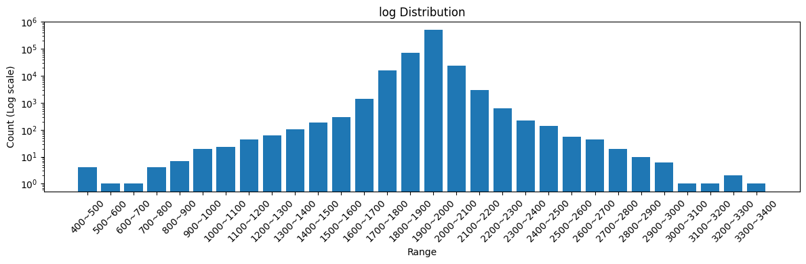
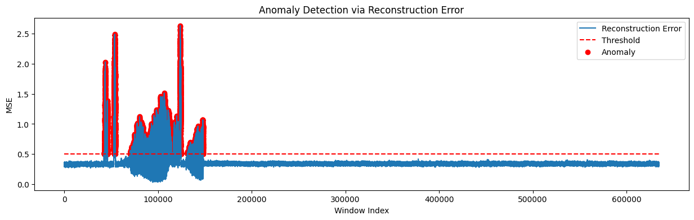

# CNC 기계 이상 소음 탐지 (LSTM 오토인코더)

> 한양대학교 ERICA 텐서프로그래밍 팀 프로젝트 (2025-1) · 담당: **모델링**

CNC 가공 기계의 소음 센서 데이터를 **정상 소음만으로 학습한 LSTM 오토인코더**에 넣고,
복원 오차가 큰 구간을 이상 소음으로 판단합니다.
이상 데이터에 라벨이 없어도, 정상 패턴을 외운 모델이 "복원하지 못하는 소리"를 찾아내는 방식입니다.

## 배경

CNC 기계는 금속·나무·플라스틱을 깎는 장비라 이상이 생기면 소음이 먼저 달라집니다.
사람이 계속 옆에서 듣고 있을 수는 없으니, 기계 근처 마이크로 소리를 모으고 AI가 이상 여부를 알려주는 구조를 목표로 했습니다.

```
마이크 소리 수집 → 전처리(스케일링·윈도우 분할) → LSTM 오토인코더 → 복원 오차 → 임계값 비교 → 알림
```

## 데이터

- 수업에서 제공받은 CNC 소음 센서 데이터 1개 파일, 634,759개 값 (1채널 시계열)
- 결측치 없음. 값은 대부분 1,900~2,000 사이에 몰려 있고, 일부 큰 피크는 실제 소리의 특징이라 제거하지 않았습니다.
- 앞 150,000개는 이상 소음 포함 구간, 뒤 484,759개는 정상 구간으로 나눴습니다.



> 데이터는 수업 제공 자료라 저장소에 포함하지 않았습니다. 실행하려면 `data/CNCnoise_1.csv`에 넣어주세요.

## 모델 (내 담당)

| 항목 | 설정 |
| --- | --- |
| 학습 데이터 | 정상 구간 100,000개만 사용 |
| 전처리 | MinMax 스케일링, 길이 50 슬라이딩 윈도우 → 입력 (99,950, 50, 1) |
| 구조 | LSTM(64) 인코더 → RepeatVector(50) → LSTM(64) 디코더 → TimeDistributed(Dense(1)) |
| 학습 | Adam, MSE 손실, batch 32, validation 20% |
| 판정 | 윈도우별 복원 MSE > 0.5 이면 이상 |

**LSTM 오토인코더를 고른 이유**
- 이상 소음은 라벨이 거의 없고 종류도 다양해서, 분류 모델보다 "정상만 학습하고 벗어나는 것을 찾는" 방식이 맞다고 판단했습니다.
- 소리는 순서가 중요한 시계열이라 시간 흐름을 기억하는 LSTM을 썼습니다.

## 결과



- 정상 구간(약 150,000번째 윈도우 이후)의 복원 오차는 약 0.3대로 안정적이고, 임계값 0.5를 넘지 않았습니다.
- 임계값을 넘은 윈도우는 모두 이상 소음이 포함된 앞 구간 안에서만 나타났습니다.

## 한계와 개선 방향

- **임계값을 0.5로 직접 정했습니다.** 정상 데이터 복원 오차의 분포(예: 평균 + 3σ, 99퍼센타일)로 정하는 방식이 더 객관적입니다.
- **정량 평가가 없습니다.** 구간 라벨을 만들어 정밀도·재현율로 평가하면 모델 비교가 가능합니다.
- 학습을 1 에포크만 진행했습니다. 에포크와 윈도우 길이를 바꿔가며 실험할 여지가 있습니다.
- 팀에서는 Isolation Forest 등 다른 이상치 탐지 모델도 함께 검토했으며, 이 저장소에는 제가 맡은 LSTM 오토인코더 부분만 담았습니다.

## 실행

```bash
pip install numpy pandas matplotlib scikit-learn tensorflow scipy
# data/CNCnoise_1.csv 준비 후
jupyter notebook notebooks/cnc_lstm_autoencoder.ipynb
```

마지막 셀은 센서 데이터를 wav 파일로 변환해 실제 소리로 들어볼 수 있게 합니다.

## 저장소 구성

```
notebooks/cnc_lstm_autoencoder.ipynb   분석·학습·탐지 노트북 (출력 포함)
images/                                README용 결과 그래프
data/                                  (비어 있음) 수업 제공 데이터 위치
```

> 노트북 출력은 Colab에서 실행한 원본 결과입니다. 저장소에 올리면서 데이터 경로를 바꾸고, 모델 셀의 정의되지 않은 변수(`input_shape` → `window_size`)를 고치고, 테스트용·중복 셀을 정리했습니다.
